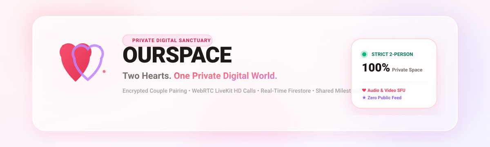
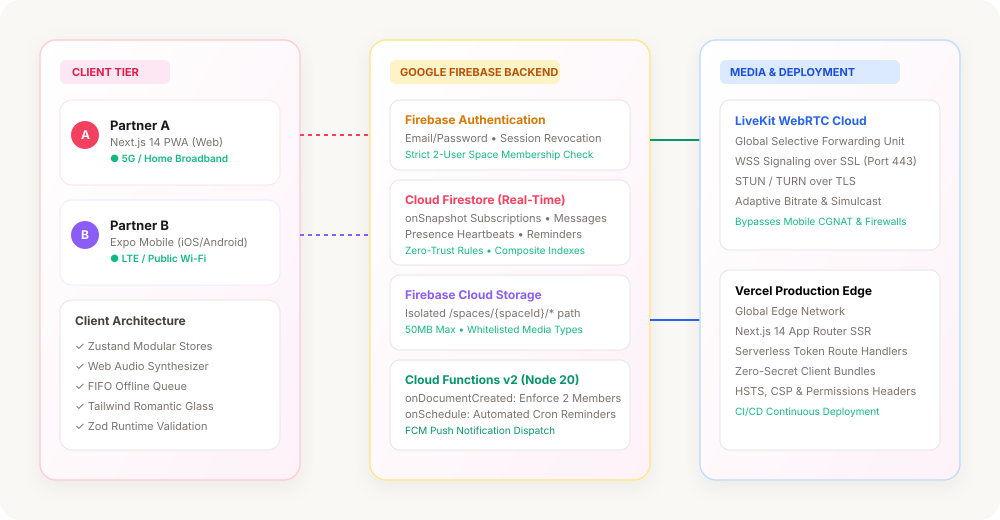

# OURSPACE

<div align="center">
  
</div>

<p align="center">
  <strong>Two Hearts. One Private Digital World.</strong><br />
  <a href="https://ourspace-app-two.vercel.app"><code>🚀 Live Production: https://ourspace-app-two.vercel.app</code></a>
</p>

<p align="center">
  <a href="https://github.com/karthibaraniofficial-wq/OURSPACE/actions/workflows/ci.yml"></a>
  <a href="https://nextjs.org"></a>
  <a href="https://react.dev"></a>
  <a href="https://www.typescriptlang.org"></a>
  <a href="https://firebase.google.com"></a>
  <a href="https://livekit.io"></a>
  <a href="https://expo.dev"></a>
  <a href="https://vercel.com"></a>
  <a href="LICENSE"></a>
</p>

---

## 🕊️ Introduction

**OURSPACE** is a private communication platform crafted exclusively for two people in a relationship. Unlike public social networks and mass messaging apps crowded with group channels, broadcast lists, and algorithms, OURSPACE creates an intimate digital sanctuary: synchronized real-time conversations, encrypted photo and video vaults, zero-latency Web Audio chime alerts, high-definition LiveKit voice and video calls, shared countdowns, and anniversary milestones.

Every space enforces strict two-person isolation. Third-party accounts cannot view, join, or discover an active couple space.

---

## 📸 Architecture & System Design

```text
OURSPACE Monorepo Architecture
├── apps/
│   ├── web/          # Next.js 14 App Router, PWA, Tailwind CSS, Framer Motion, Zustand
│   └── mobile/       # Expo (React Native) iOS & Android client
├── packages/
│   ├── types/        # TypeScript domain models, Firestore schemas & WebRTC contracts
│   ├── validation/   # Zod validation schemas for auth, pairing, messages, reminders, env
│   └── shared/       # Date math, countdown engine, Web Audio chime synthesizer, theme presets
├── functions/        # Node.js 20 Firebase Cloud Functions v2 (reminders, space limits, FCM)
├── apppackage/       # Desktop and mobile distribution packages & manifests
├── docs/             # Engineering audits, upgrade reports, networking diagrams
└── tests/            # Automated test suites covering domain logic, auth & validation
```

<div align="center">
  
</div>

---

## 🌟 Feature Overview

| Capability | Engineering Standard | User Experience |
|:---|:---|:---|
| **Atomic 2-Person Pairing** | Firestore transactional verification (`memberCount <= 2`). 48-hour cryptographically generated codes. | Single-click invitation link exchange. Instant sync once redeemed. |
| **Real-Time 1-to-1 Chat** | Firestore `onSnapshot` streaming with optimistic UI updates and local FIFO offline queue. | Text, photos, voice notes, documents, romantic emoji reactions, and typing indicators. |
| **Media Vault** | Firebase Storage with space-isolated access controls, 50MB ceiling, and MIME-type validation. | Masonry gallery categorized into Photos, Videos, and Documents with full-screen lightbox. |
| **Global Voice & Video** | LiveKit WebRTC SFU with adaptive bitrate, WebSocket signaling, and STUN/TURN-over-TLS (port 443). | Reliable calling across mobile 4G/5G CGNAT, restrictive campus Wi-Fi, and broadband. |
| **Shared Milestones** | UTC date computation engine with day-counter and countdown timers. | Days Together counter, customizable anniversaries, and shared celebrations. |
| **Reminders & Tasks** | Firestore-persisted shared tasks with recurrence rules (daily, weekly, monthly, yearly). | Real-time task syncing, confetti completion animations, and chime alerts. |
| **Zero-Latency Sound** | Native Web Audio API parametric oscillator synthesizer. | 4 romantic harmonic chime presets generated locally without network latency. |
| **Resilient Networking** | Real-time connectivity state store (`Online`, `Reconnecting`, `Offline`). | Visual connectivity pill and automatic message resynchronization upon reconnection. |

---

## 🛠️ Technology Stack

- **Web Application**: Next.js 14 (App Router), React 18, Tailwind CSS, Framer Motion, Lucide Icons, Zustand
- **Mobile Application**: Expo SDK 51, React Native 0.74, React Native Safe Area, Lucide Native
- **Backend & Authentication**: Google Firebase (Firebase Authentication, Cloud Firestore, Firebase Storage)
- **Audio & Video Infrastructure**: LiveKit WebRTC Cloud (SFU with STUN/TURN fallback)
- **Validation & Schemas**: Zod runtime schema validation
- **Cloud Computing**: Firebase Cloud Functions v2 (Node.js 20 runtime)
- **Hosting & CI/CD**: Vercel Edge Network, GitHub Actions

---

## 🚀 Getting Started

### Prerequisites

- **Node.js**: `v20.x` or `v22.x` (LTS recommended)
- **Package Manager**: `npm` (v10+) or `yarn` (v1.22+)
- **Firebase Project**: A Google Cloud / Firebase project with Authentication and Firestore enabled
- **LiveKit Account**: Free cloud instance from [livekit.io](https://livekit.io) (optional for local mock mode)

### 1. Clone the Repository

```bash
git clone https://github.com/karthibaraniofficial-wq/OURSPACE.git
cd OURSPACE
```

### 2. Install Dependencies

```bash
npm install
```

### 3. Configure Environment Variables

Create `.env.local` inside `apps/web/`:

```env
# General
NODE_ENV=development
NEXT_PUBLIC_APP_URL=http://localhost:3000

# Firebase Client SDK Configuration
NEXT_PUBLIC_FIREBASE_API_KEY=AIzaSy...
NEXT_PUBLIC_FIREBASE_AUTH_DOMAIN=your-project.firebaseapp.com
NEXT_PUBLIC_FIREBASE_PROJECT_ID=your-project
NEXT_PUBLIC_FIREBASE_STORAGE_BUCKET=your-project.appspot.com
NEXT_PUBLIC_FIREBASE_MESSAGING_SENDER_ID=123456789012
NEXT_PUBLIC_FIREBASE_APP_ID=1:123456789012:web:abcdef

# LiveKit WebRTC Infrastructure (Server credentials kept private)
NEXT_PUBLIC_LIVEKIT_URL=wss://your-subdomain.livekit.cloud
LIVEKIT_API_KEY=devkey
LIVEKIT_API_SECRET=secret

# Optional Integrations
NEXT_PUBLIC_GIPHY_API_KEY=your_giphy_key
```

### 4. Run Development Server

```bash
# Start Next.js Web App
npm run dev

# Run Automated Test Suite
npm test
```

Navigate to [http://localhost:3000](http://localhost:3000) to access the application.

---

## 🔐 Security & Privacy Architecture

OURSPACE enforces defense-in-depth principles across client, API, and storage tiers:

1. **Strict 2-Member Enforcement**:
   Firestore Security Rules prevent a third member from joining a space under any condition:
   ```javascript
   function isMemberOfSpace(spaceId) {
     return request.auth != null &&
       exists(/databases/$(database)/documents/privateSpaces/$(spaceId)/members/$(request.auth.uid));
   }
   ```
2. **Atomic Invariant Trigger**:
   Firebase Cloud Functions (`onSpaceMemberCreate`) automatically evict any unauthorized third document creation, logging security events to `auditLogs`.
3. **MIME-Type & Payload Guard**:
   Storage security rules restrict uploads to whitelisted media formats (`image/*`, `video/*`, `audio/*`, `application/pdf`) and cap file sizes at 50MB.
4. **Zero Client Secret Leakage**:
   Privileged credentials (`LIVEKIT_API_SECRET`, Firebase Service Accounts) reside exclusively in server-side route handlers and Cloud Functions. No privileged secrets are bundled into client JavaScript.
5. **Security Headers**:
   `apps/web/vercel.json` provides strict security headers on all responses: HSTS, `X-Content-Type-Options: nosniff`, `X-Frame-Options: DENY`, `Referrer-Policy: strict-origin-when-cross-origin`, and `Permissions-Policy`.

---

## 🧪 Quality Gates & Testing

The repository maintains an automated validation suite verifying domain calculations, schema validation, zero-localhost security scans, and type integrity:

```bash
# Run linting across all workspaces
npm run lint

# Run TypeScript typechecks
npm run typecheck

# Run test suites
npm test

# Run production build
npm run build
```

---

## 📱 Mobile App (iOS & Android)

The mobile client is powered by Expo SDK 51:

```bash
cd apps/mobile

# Start Expo development server
npm run start

# Launch on Android emulator
npm run android

# Launch on iOS simulator
npm run ios
```

---

## 📦 Distribution Packages

The [`apppackage/`](apppackage/) directory contains pre-configured standalone launcher assets:
- **Windows Desktop Launcher**: Native PE32+ executable with one-click shortcut installation.
- **Android Package**: Installable APK package.
- **Web PWA Package**: Progressive Web App distribution with offline caching service worker.
- **Checksum Manifest**: Verifiable SHA-256 hashes in [`apppackage/CHECKSUMS.sha256`](apppackage/CHECKSUMS.sha256).

---

## 📄 License

This project is licensed under the MIT License — see the [LICENSE](LICENSE) file for details.
