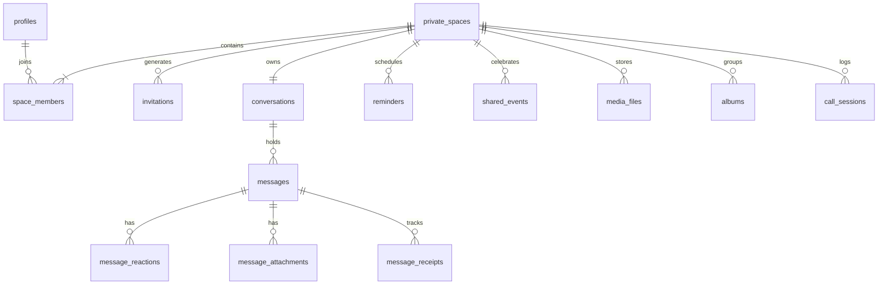

# OURSPACE — Database Architecture & Schema Documentation

## 1. Overview
The OURSPACE database is built on PostgreSQL (hosted via Supabase), engineered with strict multi-tenant isolation where each tenant is a **couple space** consisting of at most two users.

## 2. Table Index & Relationships



## 3. Strict 2-User Space Limit Mechanism
A database-level `BEFORE INSERT` trigger (`trigger_enforce_space_member_limit`) operates on `space_members`:
```sql
SELECT COUNT(*) INTO current_count
FROM public.space_members
WHERE space_id = NEW.space_id;

IF current_count >= 2 THEN
    RAISE EXCEPTION 'Space membership limit reached: OURSPACE strictly permits a maximum of 2 members per space.';
END IF;
```
This guarantees race-condition-free enforcement even under concurrent invite redemptions.

## 4. Row Level Security Helper
All space resource policies call the function `public.is_member_of_space(UUID)`:
```sql
CREATE OR REPLACE FUNCTION public.is_member_of_space(p_space_id UUID)
RETURNS BOOLEAN AS $$
BEGIN
    RETURN EXISTS (
        SELECT 1 FROM public.space_members
        WHERE space_id = p_space_id AND user_id = auth.uid()
    );
END;
$$ LANGUAGE plpgsql SECURITY DEFINER STABLE;
```

## 5. Storage Organization & Signed URLs
Storage bucket: `ourspace-media` (Private).
Path hierarchy:
`{space_id}/{category}/{file_id}_{original_filename}`
Storage policies match the first path segment (`storage.foldername(name)[1]`) against `is_member_of_space()`.
Direct file downloads require short-lived signed URLs (1 hour expiry), preventing unauthorized URL leaks.
