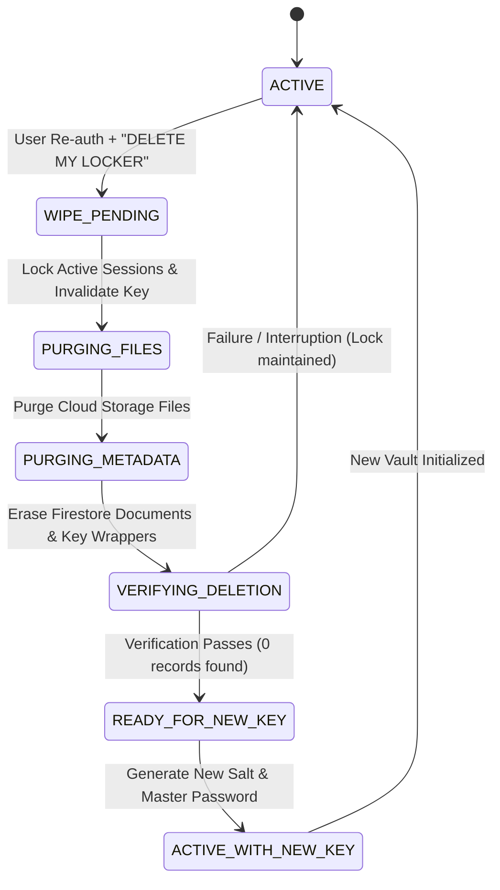

# OUR LOCKER: IRREVERSIBLE DATA ERASURE & KEY RESET SPECIFICATION

## 1. Objective & Critical Requirement
In end-to-end client-side encryption architectures, forgetting the master vault password means the data is mathematically unrecoverable. 

OURSPACE implements a strict, verified destruction protocol:
> **RESET LOCKER & ERASE ALL DATA**

A user can reset their locker key **only after all existing encrypted locker data and wrapped key material have been permanently erased and verified as destroyed**.

---

## 2. Deletion State Machine



### State Definitions
1. **ACTIVE**: Vault operational, encrypted items readable with valid master password.
2. **WIPE_PENDING**: User initiated reset, confirmed explicit typing phrase, and locked active sessions.
3. **PURGING_FILES**: Deleting all encrypted file attachments, images, and documents in Firebase Storage under `users/{uid}/vault/...`.
4. **PURGING_METADATA**: Deleting all item documents in Firestore under `users/{uid}/personalVault/{vaultId}/items/...` and vault metadata document.
5. **VERIFYING_DELETION**: Querying Firestore collections to certify that 0 documents remain and that key wrappers are eradicated.
6. **READY_FOR_NEW_KEY**: Verification certified; UI enables "Initialize Vault Key" button.
7. **ACTIVE_WITH_NEW_KEY**: A fresh 16-byte random salt is generated, a new key hierarchy is established, and a new version is created.

---

## 3. Human Confirmation Workflow
1. User navigates to **Locker Settings**.
2. Selects **Forgot Password? Reset Locker & Erase All Data**.
3. High-priority confirmation dialog warns:
   > *"This action will permanently delete all information stored in your locker. Existing encrypted files, private documents, photographs, and records will become unrecoverable. You cannot undo this operation."*
4. User must type exact case-sensitive phrase:
   ```text
   DELETE MY LOCKER
   ```
5. Wipe job executes through the orchestrated state machine.

---

## 4. Provider Backup Retention Disclosure
While OURSPACE deletes all live Firestore records and Cloud Storage objects during the wipe sequence, Google Firebase and Google Cloud maintain immutable snapshot backups for disaster recovery for up to 30 days. Residual provider backups cannot be immediately pruned via client APIs; however, because the cryptographic key material has been destroyed, any residual encrypted backups remain mathematically unreadable ciphertext.
